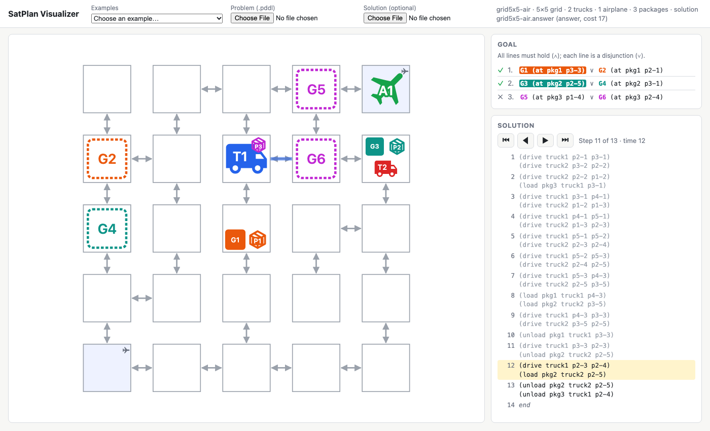

# SatPlan Visualizer

A web page that draws a grid planning problem and steps through a solution.
It runs entirely in the browser: open `index.html` (double-click it, or
`open SatPlan/Visualizer/index.html`), then pick one of the bundled examples
from the **Examples** menu, or choose a problem -- and optionally its domain
(for action costs) and a solution -- with the file choosers, or drop the files
anywhere on the page (a domain file is told from a problem by its contents). Nothing is uploaded
and no server is needed. It does not run a planner (yet).

A problem names its domain, `(:domain clara-logistics)`, but a page opened
from a file can read only the files it is given, so it cannot look the domain
up beside the problem as FiFO does. Instead it carries FiFO's domain library,
`pddl/` (bundled into `domains.js`): a problem whose domain is there gets it
automatically, as FiFO's last resort does, and its costs are exact. Choose or
drop a domain file only for a domain the library lacks, or to override it.
(The domain holds no prices: it says which function prices which action,
`(increase (total-cost) (drive-cost))`, and the problem's `:init` gives the
values, which is where ppgen's `--drive-cost` etc. go. Without a domain the
costs are guessed from the action names and marked ≈.)

(A web page cannot choose the folder its file dialog opens in -- browsers don't
allow it -- which is why the examples have a menu of their own. Most browsers
reopen the dialog in the last folder used.)



## What it shows

- **Map.** Each place is a square at its grid cell: ppgen's grid problems name
  places `p<row>-<col>`, row 1 at the top. (Other place names are laid out in
  a square in declaration order, with a warning.) Roads are lines with an
  arrowhead at each end that can be driven *to*: two arrowheads for a two-way
  road, one (and a dashed line) for a one-way road. Airports are tinted and
  marked ✈; flight routes between airports are not drawn.
- **Inside a square**: trucks (**T1**, …), airplanes (**A1**, …) and packages
  (**P1**, …) are icons, each vehicle in its own color and each package in its
  own; goal destinations (**G1**, …) are dashed outlines in the color of the
  package they are for, filled once achieved. Whatever is in a square fills
  it: a truck alone nearly fills it; vehicles share it by taking the bottom
  part, with goals and packages side by side above. Several of one kind
  overlap, each further one offset up and to the right so its edge shows, and
  they shrink to fit. A vehicle carries its packages as small badges. Hover
  over anything for its full name.
- **Goal.** The hard goal, as one line per conjunct; each line is a
  disjunction. Preferences are ignored. A disjunct achieved in the displayed
  state is highlighted in its package's color, and each line is marked ✓ when
  one of its disjuncts holds.
- **Utility so far.** Three numbers for the displayed step:
  - **Goals**: the weights of the preferences achieved in the displayed state
    (`(preference NAME GD WEIGHT)`, or a weight from the metric's
    `(* W (is-violated NAME))`); "–" when the problem weights none;
  - **Costs**: minus the cost of the actions taken so far, from the domain's
    `(increase (total-cost) X)` effects, `X` a number or a function the
    problem's `:init` gives a value (`(= (drive-cost) 2)`). Without a domain
    file the costs are estimated -- a drive costs `drive-cost`, a fly
    `fly-cost`, anything else 0 -- and marked ≈. "–" when there are no costs;
  - **Total**: Goals + Costs.

  At the end of a FiFO solution, the unachieved preference weights plus the
  cost equal the answer's `*OBJECTIVE*`. Hover over a number for where it
  comes from.

  **Pseudo Goal Utility** (a whole number, typed or stepped with − and +;
  0, the default, is off): for a problem that weights no goals, count that much
  for each distinct goal literal achieved in the displayed state, so Goals and
  Total show progress toward the goal. It is for display only -- the
  problem's own utility is unchanged, and the CLARA browser's plan values never
  include it. A problem with goal utilities is shown as it is.
- **Solution.** The actions by step. ◀ ▶ (or the arrow keys, Home and End)
  step through it; clicking a step jumps there. The map shows the state at the
  current step, and the drives about to be taken are drawn in their vehicle's
  color.

## Solution formats

| Format | Example | Notes |
|---|---|---|
| FiFO `.answer` | `(OCCURS (DRIVE TRUCK1 P2-1 P3-1) 1)` | `HOLDS` facts give the state at each slice |
| action `@` step | `(drive truck1 p2-1 p3-1) @ 1` | `.answer` with each `OCCURS` rewritten; `HOLDS` lines optional |
| plain list | `(drive truck1 p2-1 p3-1)` | one action per step; `t: (action)` groups by step, a trailing `[cost]` is ignored |

Where the file has `HOLDS` facts for a step, the state is read from them;
otherwise it is computed by applying the actions (load, unload, transfer,
drive, fly, and the classic logistics names load-truck, drive-truck, …). When
both exist they are compared, and any disagreement is shown as a warning, as
are actions naming objects the problem does not have.

`examples/` has a 6×6 problem (two trucks, four packages, a 12-way disjunctive
goal with 12 weighted preferences, drives costing 2) with its FiFO answer
(objective 96: 11 unachieved preferences of 8, plus 3 drives and a load and an
unload), and a 5×5 problem with two airports and an airplane, whose goal is a
conjunction of three disjunctions, with its solution in all three formats
(cost 23: 17 drives, 3 loads, 3 unloads). Both use FiFO's `clara-logistics`
domain (a copy is bundled): every load and unload costs `(handle-cost)`, set to
1 in each problem's `:init`. The solutions are EvalMaxSAT's proved optima at the
shortest horizon (14 and 6 slices). The Examples menu lists
each problem alone and with each solution whose file name starts with the
problem's name followed by `.` or `-`, and loads the problem's domain with it.
To add an example, put its files in `examples/` and run `build.sh`.

With a CLARA checkout beside FiFO (or its path as the argument, or in
`CLARA_DIR`), `bash SatPlan/Visualizer/build-clara-examples.sh` adds a **CLARA** button
left of the Examples menu: it mirrors SimpleGrid, TwoPackage,
TwoPackageOneway, ThreePackage and FourPackage (with their `goals/` and
`recognition/`) into `clara-examples/` as symbolic links -- not
AAAI-2010-Benchmarks, whose blocks-world and intrusion-detection problems the
grid map cannot draw -- and `build.sh` bundles that into `clara-examples.js`,
which the page loads after `examples.js` (about 1,100 problems, 17 MB). Both are git-ignored,
since they depend on the local checkout; rerun the script after pulling CLARA.
Without them the button is hidden.
In a tree, a problem's domain is the one beside it, else the nearest parent
directory's, and its solutions are those in its own directory.

The button opens a column browser, read from CLARA's file names
(`src/clara.ts`):

| Column | From | Example |
|---|---|---|
| Family | the top directory | `ThreePackage` |
| Size | `gridNxM-` | `5×5` |
| Instance | the seed `K` of `gridNxM-K` | `1` |
| Goal | `goals/gridNxM-K-<goal>.pddl`, plus the problem itself (`original problem`) and `recognition/` (`recognition problem`) | `pkg1 at p2-4, pkg2 at p3-4, pkg3 at p4-3` |
| Solver | `-eval.answer` (EvalMaxSAT, exact), `-tt.answer` (tt-open-wbo-inc, anytime), or the problem alone | `EvalMaxSAT - exact (−5)` |

`<goal>.answer` is a copy of one of the two (the one CLARA cut its evidence
files from; the plan itself involves no evidence), so it is not listed again.
Nothing in the browser involves evidence. (A
problem whose name is not `gridNxM-K` would be placed by its directory: Size
the subdirectory, Instance the file name.) A solver with no plan file for that goal (it
timed out, or was stopped) is grayed, and so is a goal with no plan at all;
either can still be opened, to show the problem alone, as can
"no solution (problem only)". Choosing a row fills the next column; Open, a
double click or Enter loads the problem, its domain and the solution. The
arrow keys move within and between columns.

Each plan's row ends with its **value** in parentheses, e.g.
`EvalMaxSAT - exact (−5)`: the Total the main page shows at the plan's last
step with Pseudo Goal Utility off -- the weights of the preferences achieved
minus the cost, so minus the cost for CLARA's problems, which weight no goals.
It is computed as the page computes Total (the problem, its domain and the
plan, parsed when the browser first opens).

The **original problem** lists its own plans if CLARA has any
(`gridNxM-K-eval.answer` and so on). CLARA makes none, so otherwise it offers,
under its solver's name, the best of the plans for its goals: the one of
highest value for the original problem -- valued against the original
problem's goal utilities, if it has any, not the goal problem's -- which is the
lowest-cost one when it weights no goals; the exact solver's on a tie; and only
a plan that achieves the original problem's hard goal. That is what solving the
original problem directly would usually find, but not certainly: each goal plan
is optimal only at its own goal's shortest horizon (and an anytime plan is not
proven optimal at all). The footer names the goal the plan was found for. The
recognition problem (the same goal at the recognition horizon) gets no such
plan. A plan whose problem has neither costs nor goal utilities shows no value.

## The circuit visualizer

`circuit.html` is a second page, for **plan recognition over a compiled
circuit**: a problem together with the d-DNNF circuit of its recognition theory
(`marginals.sh --solver ddnnf|d4 --save-circuit`, or CLARA's `*/circuits/`).
Add observations -- step through an evidence file, or enter them by hand -- and
it shows, for every hypothesis (a disjunct of the goal, at the final slice),
P(h | E) and the likelihood posterior P(E | h) / Σ P(E | h′) with a uniform
prior.  The map shows the initial state with the observed actions on it and
each goal shaded by its probability.  The design, the protocols and what is
not supported yet are in [CIRCUIT-PLAN.md](CIRCUIT-PLAN.md).

It needs a server, which holds the circuit in FiFO's Lisp:

```sh
python3 SatPlan/Visualizer/server/circuit_server.py --open
    # the bundled example (circuit-examples/: CLARA TwoPackage grid3x3-1)
python3 SatPlan/Visualizer/server/circuit_server.py --clara ~/Programming/CLARA --open
    # CLARA's circuits, in the page's CLARA browser (below); the same as
bash SatPlan/Visualizer/run-circuit-clara.sh
    # which finds CLARA as build-clara-examples.sh does; more options go to the server
python3 SatPlan/Visualizer/server/circuit_server.py \
    --session PROBLEM.pddl CIRCUIT.dnnf EVIDENCE-DIR-or-FILES... --open
```

then open http://127.0.0.1:8765/ (`--open` does it).

With `--clara`, a **CLARA** button opens a column browser -- Family, Size,
Instance, Evidence -- over every original problem of SimpleGrid, TwoPackage,
TwoPackageOneway, ThreePackage and FourPackage. Evidence is "no evidence" or
a goal: the whole of the plan for it (`<goal>-obs100.txt`), opened before
its first observation -- step through it with ▶ as far as wanted (CLARA's 25%
file is just its start). Choosing other evidence for the
circuit already open does not reload it. A problem whose circuit is on disk
opens; one whose circuit failed to compile, or was never compiled (its
family's `results/compile-d4.jsonl`), is grayed and cannot be opened, and the
footer says why; a family or size with no compiled circuit is grayed too. A
circuit committed in `.part-*` pieces is joined into its git-ignored whole
file when opened, and joined again whenever a piece is newer (after a pull),
as CLARA's `reassemble.sh` would. The Session menu then lists only sessions
given with `--session`.

A CLARA session scores the problem its circuit was compiled from,
`recognition/<name>.pddl`: the goal as ONE `(or ...)` of hypotheses. A
hypothesis that is not a single literal -- ThreePackage's are conjunctions,
one destination per package -- is the atom `recognize.sh` created for it,
`(HOLDS (RECHYP<i>) H)`. The map and the Goal panel draw the top-level problem,
whose goal names each package's destinations; when the hypotheses are
conjunctions that put some object at different places (so no two can hold
at once, and the goal requires one), a destination's probability is the sum
over the hypotheses that include it.

Once a circuit is loaded, a line under the header gives its size: the file's
bytes and its nodes. The nodes are those of the circuit as FiFO saves and loads
it, every literal a node of its own -- more than the `nodes` of CLARA's compile
records, which count d4's own form (literals on its edges).  The server needs python3
(standard library only) and SBCL with FiFO: the installed one (`~/lib/fifo/lisp`)
or `FIFO_LISP`.  `?session=NAME&evidence=FILE&step=K` in the page's address
opens that view directly.

Evidence must be **pinned unit literals** over atoms the circuit keeps -- e.g.
`(occurs (drive truck1 p2-3 p3-3) 1)` or its `(not ...)`: each is a clamp on
the compiled circuit, so a query is two passes over it (milliseconds for a
3x3, about a second for a million-node circuit).  Ordering evidence
(`occur-in-order`, CLARA's `-ordK.txt`), compound formulas and atoms a
projected circuit dropped would need a recompile per change and are refused
with the reason.

The bundled example, `circuit-examples/`, is CLARA TwoPackage `grid3x3-1` under
the current `clara-logistics` domain: its recognition problem, the d4 circuit
CLARA compiled for it, the theory as a self-contained `.wff`, and evidence files
cut by `evgen.sh` from CLARA's goal plans (`-obs1`/`-obs5`, the first 1 or 5
observed actions; `-ord1`, an ordering form, which the page refuses). Beside it
is `grid3x3-1-pairs`, the same world with four conjunctions as its hypotheses,
for the test of compound hypotheses.

`tests/run-test-circuit-viz.sh` checks the numbers against SharpSAT-TD counting
the example's theory (regenerated from its `.wff`) with the same evidence -- for
`grid3x3-1-pairs` with each conjunction's own literals, not the atom the server
reads for it -- plus the parsing, the refusals and the HTTP routes.

## Code

TypeScript in `src/`, compiled to the single script `visualizer.js`; the
examples are bundled into `examples.js` and FiFO's domain library into `domains.js` (a page opened from a file may not read
other files itself). All three are checked in, so the page works without building:

| File | Contents |
|---|---|
| `src/sexpr.ts` | s-expression reader (PDDL and answer files) |
| `src/problem.ts` | the problem: objects, roads, initial state, goal lines, grid layout |
| `src/domain.ts` | a domain's action parameters and costs; the cost of a ground action |
| `src/plan.ts` | the three solution formats, plan simulation, goal evaluation, running utility |
| `src/render.ts` | the map as SVG |
| `src/columns.ts` | the column browser both pages' CLARA buttons open |
| `src/clara.ts` | the plan page's CLARA columns, from CLARA's file names; plan values |
| `src/app.ts` | the page: file loading, panels, stepping, the CLARA browser; `Viz.load(...)` for programmatic use |
| `src/circuit-app.ts` | the circuit visualizer page (built into `circuit.js` with the shared modules) |
| `server/circuit_server.py` | the circuit visualizer's HTTP server, sessions, evidence files; drives the Lisp |
| `server/circuit-server.lisp` | the Lisp side: load a circuit, find the hypotheses, clamp and evaluate |
| `tools/bundle-examples.ts` | writes `examples.js` from `examples/`, `clara-examples.js` from `clara-examples/`, and `domains.js` from `pddl/` |

After changing anything in `src/`, `examples/` or `pddl/`, rebuild and test:

```sh
bash SatPlan/Visualizer/build.sh      # writes visualizer.js, circuit.js, examples.js, domains.js
bash tests/run-test-visualizer.sh     # also fails if visualizer.js, examples.js or domains.js is stale
bash tests/run-test-circuit-viz.sh    # the circuit visualizer; fails if circuit.js is stale
```

The icons are from [Material Design Icons](https://pictogrammers.com/library/mdi/)
(Apache License 2.0): `truck`, `airplane` and `package-variant-closed`, embedded
as SVG paths in `src/render.ts`.

The tests (`tests/test.ts`, run under Node) check the plan simulation against
FiFO's own `HOLDS` states: the same plan with the `HOLDS` lines removed must
reproduce every one of them.
