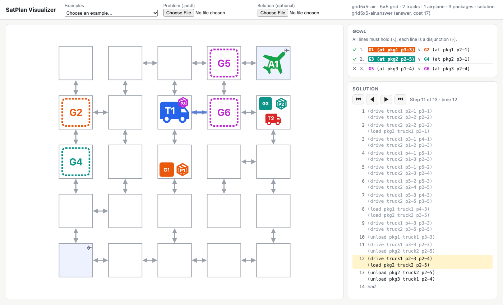

# SatPlan Visualizer

A web page that draws a grid planning problem and steps through a solution.
It runs entirely in the browser: open `index.html` (double-click it, or
`open SatPlan/Visualizer/index.html`), then pick one of the bundled examples
from the **Examples** menu, or choose a problem -- and optionally its domain
(for action costs) and a solution -- with the file choosers, or drop the files
anywhere on the page (a domain file is told from a problem by its contents). Nothing is uploaded
and no server is needed. It does not run a planner (yet).

(A web page cannot choose the folder its file dialog opens in -- browsers don't
allow it -- which is why the examples have a menu of their own. Most browsers
reopen the dialog in the last folder used.)



## What it shows

- **Map.** Each place is a square at its grid cell: ppgen's grid problems name
  places `p<row>-<col>`, row 1 at the top. (Other place names are laid out in
  a square in declaration order, with a warning.) Roads are lines with an
  arrowhead at each end that can be driven *to*: two arrowheads for a two-way
  road, one (and a dashed line) for a one-way road. Airports are tinted and
  marked ✈; flight routes between airports are not drawn.
- **Inside a square**: trucks (**T1**, …), airplanes (**A1**, …) and packages
  (**P1**, …) are icons, each vehicle in its own color and each package in its
  own; goal destinations (**G1**, …) are dashed outlines in the color of the
  package they are for, filled once achieved. Whatever is in a square fills
  it: a truck alone nearly fills it; vehicles share it by taking the bottom
  part, with goals and packages side by side above. Several of one kind
  overlap, each further one offset up and to the right so its edge shows, and
  they shrink to fit. A vehicle carries its packages as small badges. Hover
  over anything for its full name.
- **Goal.** The hard goal, as one line per conjunct; each line is a
  disjunction. Preferences are ignored. A disjunct achieved in the displayed
  state is highlighted in its package's color, and each line is marked ✓ when
  one of its disjuncts holds.
- **Utility so far.** Three numbers for the displayed step:
  - **Goals**: the weights of the preferences achieved in the displayed state
    (`(preference NAME GD WEIGHT)`, or a weight from the metric's
    `(* W (is-violated NAME))`); "–" when the problem weights none;
  - **Costs**: minus the cost of the actions taken so far, from the domain's
    `(increase (total-cost) X)` effects, `X` a number or a function the
    problem's `:init` gives a value (`(= (drive-cost) 2)`). Without a domain
    file the costs are estimated -- a drive costs `drive-cost`, a fly
    `fly-cost`, anything else 0 -- and marked ≈. "–" when there are no costs;
  - **Total**: Goals + Costs.

  At the end of a FiFO solution, the unachieved preference weights plus the
  cost equal the answer's `*OBJECTIVE*`.
- **Solution.** The actions by step. ◀ ▶ (or the arrow keys, Home and End)
  step through it; clicking a step jumps there. The map shows the state at the
  current step, and the drives about to be taken are drawn in their vehicle's
  color.

## Solution formats

| Format | Example | Notes |
|---|---|---|
| FiFO `.answer` | `(OCCURS (DRIVE TRUCK1 P2-1 P3-1) 1)` | `HOLDS` facts give the state at each slice |
| action `@` step | `(drive truck1 p2-1 p3-1) @ 1` | `.answer` with each `OCCURS` rewritten; `HOLDS` lines optional |
| plain list | `(drive truck1 p2-1 p3-1)` | one action per step; `t: (action)` groups by step, a trailing `[cost]` is ignored |

Where the file has `HOLDS` facts for a step, the state is read from them;
otherwise it is computed by applying the actions (load, unload, transfer,
drive, fly, and the classic logistics names load-truck, drive-truck, …). When
both exist they are compared, and any disagreement is shown as a warning, as
are actions naming objects the problem does not have.

`examples/` has a 6×6 problem (two trucks, four packages, a 12-way disjunctive
goal) with its FiFO answer, and a 5×5 problem with two airports and an
airplane, whose goal is a conjunction of three disjunctions, with its solution
in all three formats, and the two domains they name. The Examples menu lists
each problem alone and with each solution whose file name starts with the
problem's name followed by `.` or `-`, and loads the problem's domain with it.
To add an example, put its files in `examples/` and run `build.sh`.

## The circuit visualizer

`circuit.html` is a second page, for **plan recognition over a compiled
circuit**: a problem together with the d-DNNF circuit of its recognition theory
(`marginals.sh --solver ddnnf|d4 --save-circuit`, or CLARA's `*/circuits/`).
Add observations -- step through an evidence file, or enter them by hand -- and
it shows, for every hypothesis (a disjunct of the goal, at the final slice),
P(h | E) and the likelihood posterior P(E | h) / Σ P(E | h′) with a uniform
prior.  The map shows the initial state with the observed actions on it and
each goal shaded by its probability.  The design, the protocols and what is
not supported yet are in [CIRCUIT-PLAN.md](CIRCUIT-PLAN.md).

It needs a server, which holds the circuit in FiFO's Lisp:

```sh
python3 SatPlan/Visualizer/server/circuit_server.py --open
    # the bundled example (circuit-examples/: CLARA TwoPackage grid3x3-1)
python3 SatPlan/Visualizer/server/circuit_server.py --clara ~/Programming/CLARA --open
    # every CLARA problem with a saved circuit, with its evidence files
python3 SatPlan/Visualizer/server/circuit_server.py \
    --session PROBLEM.pddl CIRCUIT.dnnf EVIDENCE-DIR-or-FILES... --open
```

then open http://127.0.0.1:8765/ (`--open` does it).  The server needs python3
(standard library only) and SBCL with FiFO: the installed one (`~/lib/fifo/lisp`)
or `FIFO_LISP`.  `?session=NAME&evidence=FILE&step=K` in the page's address
opens that view directly.

Evidence must be **pinned unit literals** over atoms the circuit keeps -- e.g.
`(occurs (drive truck1 p2-3 p3-3) 1)` or its `(not ...)`: each is a clamp on
the compiled circuit, so a query is two passes over it (milliseconds for a
3x3, about a second for a million-node circuit).  Ordering evidence
(`occur-in-order`, CLARA's `-ordK.txt`), compound formulas and atoms a
projected circuit dropped would need a recompile per change and are refused
with the reason.

`tests/run-test-circuit-viz.sh` checks the numbers against SharpSAT-TD counting
the example's theory (regenerated from its `.wff`) with the same evidence, plus
the parsing, the refusals and the HTTP routes.

## Code

TypeScript in `src/`, compiled to the single script `visualizer.js`; the
examples are bundled into `examples.js` (a page opened from a file may not read
other files itself). Both are checked in, so the page works without building:

| File | Contents |
|---|---|
| `src/sexpr.ts` | s-expression reader (PDDL and answer files) |
| `src/problem.ts` | the problem: objects, roads, initial state, goal lines, grid layout |
| `src/domain.ts` | a domain's action parameters and costs; the cost of a ground action |
| `src/plan.ts` | the three solution formats, plan simulation, goal evaluation, running utility |
| `src/render.ts` | the map as SVG |
| `src/app.ts` | the page: file loading, panels, stepping; `Viz.load(...)` for programmatic use |
| `src/circuit-app.ts` | the circuit visualizer page (built into `circuit.js` with the shared modules) |
| `server/circuit_server.py` | the circuit visualizer's HTTP server, sessions, evidence files; drives the Lisp |
| `server/circuit-server.lisp` | the Lisp side: load a circuit, find the hypotheses, clamp and evaluate |
| `tools/bundle-examples.ts` | writes `examples.js` from `examples/` |

After changing anything in `src/` or `examples/`, rebuild and test:

```sh
bash SatPlan/Visualizer/build.sh      # writes visualizer.js, circuit.js and examples.js
bash tests/run-test-visualizer.sh     # also fails if visualizer.js or examples.js is stale
bash tests/run-test-circuit-viz.sh    # the circuit visualizer; fails if circuit.js is stale
```

The icons are from [Material Design Icons](https://pictogrammers.com/library/mdi/)
(Apache License 2.0): `truck`, `airplane` and `package-variant-closed`, embedded
as SVG paths in `src/render.ts`.

The tests (`tests/test.ts`, run under Node) check the plan simulation against
FiFO's own `HOLDS` states: the same plan with the `HOLDS` lines removed must
reproduce every one of them.
